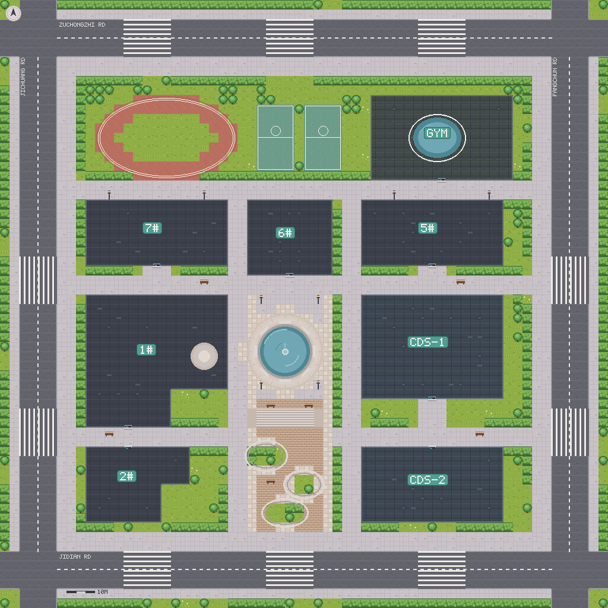

# 张江学园 · 集电校区 — Pixel Campus Tile Map

一张给 **agent / 游戏引擎** 直接消费的像素校园 tile map。

- **布局** 来自你拍的街区平面（`IMG_5550.HEIC`）：祖冲之路 / 集创路 / 芳春路 / 集电路 围出的一个街区，北侧 7#、6#、5#，西侧 1#、2#，东侧 CDS-1、CDS-2，中间是圆形喷泉广场、砖石前庭和大台阶。
- **画风** 来自 `微信图片_20261121125129_228_236.png`：16px 底、2px 色块、克制的草地 / 浅灰铺装 / 沥青 / 深色屋顶调色板。
- **机器可读**：语义网格（glyph）+ 数值 tile id + `walkable` 掩码 + 建筑矩形 + POI + A* 寻路，零依赖。



---

## 文件

| 文件 | 用途 |
|---|---|
| `campus.tilemap.json` | **主数据**。64×64 语义网格、图例、walkable、建筑、POI、道路、区域、tileset 元数据 |
| `campus.tmj` | Tiled 1.10 兼容工程（ground / props / objects 三层），可直接拖进 Tiled |
| `tileset.png` | 8 列 × 3 行、每格 16×16 的图集（透明底），共 23 个 tile（id 0–22） |
| `tileset@4x.png` | 带编号的 4× 图集参考 |
| `campus_preview.png` | 2048×2048 成品图（含楼号、路名、指北针、比例尺） |
| `campus_preview_1024.png` | 1024 预览图（上面那张） |
| `campus_clean.png` | 2048×2048 无标签成品图，适合直接当游戏底图 |
| `campus_clean_1024.png` | 无标签 1024 版 |
| `campus_legend.png` | 人类图例：tile、道路、建筑、POI、缩略图 |
| `campus_ascii.txt` | 三层 ASCII（ground / props / walkable）+ POI 坐标，方便直接塞进 LLM 上下文 |
| `viewer.html` | 可交互检查器：网格、阻挡区、逐格信息、点地寻路、缩放 |
| `agent/nav.mjs` | 零依赖导航库：`createNav`、`findPath`、`reachableFrom`、`toAscii`、`describe` |
| `agent/load.mjs` | 命令行：`info` / `tile` / `path` / `near` / `ascii` / `reachable` |
| `agent/check.mjs` | 16 组结构 + 可达性 + 寻路 + Tiled 一致性测试 |
| `tools/build_tilemap.py` | 生成器：改布局、配色、装饰后重新出全套资源 |
| `serve.sh` | 本地静态服务（viewer 需要 http，不能 `file://`） |

打开检查器：

```bash
./serve.sh              # http://localhost:8099/viewer.html
```

---

## 规格

| 项 | 值 |
|---|---|
| 网格 | 64 × 64 tiles |
| tile | 16 × 16 px |
| 逻辑尺寸 | 1024 × 1024 px |
| 展示倍率 | ×2（成品图 2048 × 2048） |
| 坐标 | 左上角原点，x 向右，y 向下 |
| 地图坐标 → 像素 | `px = x * 16 * 2`（成品图），`px = x * 16`（逻辑） |
| 滚动/缩放 | 无固定摄像机要求；一格就是 16 逻辑像素 |

每一格由 **ground**（地表）和 **props**（物件）两层决定。`walkable` 的规则非常直白：

```text
walkable = legend.ground[ground].walkable && !legend.props[props].solid
```

`layers.walkable` 已经把结果算好（`'1'` 可走 / `'0'` 阻挡），直接读它就行，不用自己再推。

---

## 图例

### 地表 ground

| glyph | tile id | 名称 | 可走 | 说明 |
|---|---|---|---|---|
| `g` | 0–2 | 草地 | ✅ | 三种变体，随机微纹理 |
| `f` | 3 | 开花草地 | ✅ | 草地 + 小白花/小黄花 |
| `u` | 4 | 草丛 | ✅ | 草地 + 草簇 |
| `p` | 5–6 | 人行道 | ✅ | 浅灰铺装 |
| `P` | 7 | 石材广场 | ✅ | 圆形广场、轴线路缘 |
| `b` | 8 | 砖石广场 | ✅ | 中央砖红色前庭 |
| `r` | 9 | 车行道 | ❌ | 四邻道路，不可横穿 |
| `z` | 10 | 斑马线（横穿横路） | ✅ | 南北门过街 |
| `x` | 11 | 斑马线（纵穿竖路） | ✅ | 东西门过街 |
| `k` | 12 | 塑胶跑道 | ✅ | 田径场 |
| `c` | 13 | 球场 | ✅ | 两块室外球场 |
| `s` | 14 | 台阶 | ✅ | 中央大台阶 |
| `w` | 15 | 水面 | ❌ | 喷泉水面 |

### 物件 props

| glyph | tile id | 名称 | 阻挡 |
|---|---|---|---|
| `.` | — | 空 | 否 |
| `H` | 16 | 绿篱 | ✅ |
| `T` | 17 | 树 | ✅ |
| `n` | 18 | 长椅 | ✅ |
| `l` | 19 | 路灯 | ✅ |
| `B` | 20–22 | 建筑屋顶 | ✅ |

`B` 具体用哪张屋顶由 `buildings[].roofTileId` 决定：教学楼 20、CDS 21、体育馆 22。

---

## 建筑

| id | 标签 | 名称 | 矩形（x0,y0,x1,y1，含端点） | 门（POI） | 屋顶 |
|---|---|---|---|---|---|
| `b7` | 7# | 7 号楼 | 9,21 → 23,27 | (16, 28) 南 | teach / 20 |
| `b6` | 6# | 6 号楼 | 26,21 → 34,28 | (30, 29) 南 | teach / 20 |
| `b5` | 5# | 5 号楼 | 38,21 → 52,27 | (45, 28) 南 | teach / 20 |
| `b1` | 1# | 1 号楼（L 形） | 9,31 → 23,40 + 9,41 → 17,44 | (13, 45) 南 | teach / 20 |
| `b2` | 2# | 2 号楼（L 形） | 9,47 → 19,50 + 9,51 → 16,54 | (13, 46) 北 | teach / 20 |
| `cds1` | CDS-1 | CDS-1 | 38,31 → 52,41 | (45, 42) 南 | cds / 21 |
| `cds2` | CDS-2 | CDS-2 | 38,47 → 52,54 | (45, 46) 北 | cds / 21 |
| `gym` | GYM | 体育馆 | 39,10 → 53,18 | (46, 19) 南 | gym / 22 |

1# 屋顶上的圆形天井、体育馆屋顶的圆形天窗，都是对原图里圆形开口的致敬，纯视觉，不改变碰撞。

---

## POI

共 18 个。全部落在可走格上，且从出生点可达（由 `check.mjs` 验证）。

| id | 名称 | 坐标 | kind | 建议动作 |
|---|---|---|---|---|
| `spawn` | 中央大道南端 | 30,56 | spawn | 出生点，朝北 |
| `gate_south` | 集电路 · 南门 | 30,57 | gate | 离校 / company visit |
| `gate_north` | 祖冲之路 · 北门 | 30,7 | gate | 去地铁 / 进城 |
| `gate_west` | 集创路 · 西门 | 6,29 | gate | 去隔壁园区 |
| `gate_east` | 芳春路 · 东门 | 57,29 | gate | 去食堂 / 宿舍 |
| `b7` | 7 号楼 | 16,28 | building_entrance | enter |
| `b6` | 6 号楼 | 30,29 | building_entrance | enter |
| `b5` | 5 号楼 | 45,28 | building_entrance | enter |
| `b1` | 1 号楼 | 13,45 | building_entrance | enter |
| `b2` | 2 号楼 | 13,46 | building_entrance | enter |
| `cds1` | CDS-1 | 45,42 | building_entrance | enter（主教学楼 / lab） |
| `cds2` | CDS-2 | 45,46 | building_entrance | enter |
| `gym` | 体育馆 | 46,19 | building_entrance | enter / 打球 |
| `track` | 田径场 | 17,14 | sport | run（心情 +） |
| `courts` | 室外球场 | 28,14 | sport | play |
| `fountain` | 圆形喷泉广场 | 30,34 | landmark | 拍照 / 休息 |
| `stairs` | 中央大台阶 | 30,43 | landmark | 集合 / 拍照 |
| `brick_plaza` | 砖石广场 | 30,50 | plaza | 摆摊 / 活动 |

道路对象（`map.roads`）：

| id | 中文 | English | 轴向 |
|---|---|---|---|
| `zuchongzhi` | 祖冲之路 | ZUCHONGZHI RD | 横向 |
| `jichuang` | 集创路 | JICHUANG RD | 纵向 |
| `fangchun` | 芳春路 | FANGCHUN RD | 纵向 |
| `jidian` | 集电路 | JIDIAN RD | 横向 |

---

## Agent 用法

### Node（推荐）

```js
import { readFileSync } from 'node:fs';
import { createNav, findPath, pathBetweenPois, pathToCsv } from './agent/nav.mjs';

const map = JSON.parse(readFileSync('./campus.tilemap.json', 'utf8'));
const nav = createNav(map);

nav.walkable(30, 56);              // true
nav.describe(45, 35);              // { walkable:false, ground:{...}, prop:{...} }
nav.poi('cds1');                   // { x:45, y:42, zh:'CDS-1', ... }
nav.nearestWalkable(45, 35, 6);    // 点到楼里也能落到最近的门口/路面

const path = pathBetweenPois(nav, 'spawn', 'cds1');
console.log(path.length - 1);      // 29 步
console.log(pathToCsv(path));      // "30,56 30,55 31,55 ... 45,42"
```

`nav` 还提供：`reachableFrom(start)`、`neighbors(x,y)`、`groundInfo`、`propInfo`、`regions`、`roads`。
所有函数都是纯函数、无 DOM 依赖，浏览器里也能直接 import。

### Python

```python
import json
from collections import deque

m = json.load(open('campus.tilemap.json'))
walk = m['layers']['walkable']
cols, rows = m['size']['cols'], m['size']['rows']

def ok(x, y):
    return 0 <= x < cols and 0 <= y < rows and walk[y][x] == '1'

def bfs(start):
    seen = {start}
    q = deque([start])
    while q:
        x, y = q.popleft()
        for nx, ny in ((x+1,y),(x-1,y),(x,y+1),(x,y-1)):
            if ok(nx, ny) and (nx, ny) not in seen:
                seen.add((nx, ny)); q.append((nx, ny))
    return seen

reach = bfs((30, 56))
assert (45, 42) in reach       # CDS-1 门口
```

### CLI

```bash
node agent/load.mjs info
node agent/load.mjs tile 30 56
node agent/load.mjs path spawn cds1
node agent/load.mjs path 30 56 45 42
node agent/load.mjs near 17 14 5
node agent/load.mjs ascii 20 28 44 48
node agent/load.mjs reachable
```

输出示例：

```text
from (30,56) to (45,42)  steps=29
arrives at: cds1
30,56 30,55 31,55 31,54 32,54 ... 44,42 45,42
```

### 喂给 LLM 的最小上下文

1. 名称、尺寸、坐标约定；
2. 图例（哪几个 glyph 可走、哪些不可走）；
3. POI 表 + 建筑矩形；
4. 需要局部地形时，从 `campus_ascii.txt` 或 `toAscii()` 裁一块矩形给它。

```js
import { toAscii } from './agent/nav.mjs';
console.log(toAscii(nav, { x0: 24, y0: 28, x1: 38, y1: 46 }));
// #=阻挡 .=可走 @=spawn 字母=POI
```

`campus_ascii.txt` 里已经带了三层完整 ASCII 和坐标尺，可以直接 `cat` 进上下文（约 15 KB）。

### 寻路语义

- 4 邻域，单位代价，坐标相邻即一步；`findPath` 用 A*，同代价按入堆顺序稳定展开，结果可复现。
- 道路 `r` 不可走，**只能走斑马线 `z` / `x`** 跨越四邻道路。
- 目标格不可走时（例如点到楼顶、喷泉水面），默认自动吸附到半径 6 内最近的可走格；`{ noSnap: true }` 关闭。
- 地图边界外一律视为阻挡。
- `nav.reachableFrom(spawn)` 当前覆盖 1869 个可走格，18 个 POI 全部可达；四个方向的斑马线都能走到城市侧人行道。

---

## 渲染与资源

- `tileset.png` 是标准图集：8 列、每格 16px、RGBA。按 `id % 8`、`id // 8` 取格即可。
- `campus_clean.png` 已经按 2× 渲染好（2048px）。如果引擎需要逻辑尺寸，把图缩到 1024 或用 16px 图集自己铺。
- 成品图里的 **路缘、虚线、斑马线、屋顶女儿墙、喷泉石圈、树影** 是生成器在拼图后叠加的渲染细节；`tileset.png` 和 `campus.tmj` 只包含基础 tile。想在自己的引擎里得到 100% 同款，直接用 `campus_clean.png` 当底图，再用 `walkable` 做碰撞；想改地图就重跑生成器。
- `campus.tmj` 可直接在 Tiled 打开编辑；`objects` 层包含 POI 点和建筑矩形（L 形楼只导出了主矩形，完整分解在 JSON 的 `rects` 里）。
- 生成器需要 Pillow（macOS 自带 Python 没有的话用 DSH 的运行时）：

```bash
python3 tools/build_tilemap.py
node agent/check.mjs
```

配色集中在 `tools/build_tilemap.py` 顶部的 `P` 字典；布局在 `# layout` 段（道路、建筑、广场、斑马线、POI、装饰）。改完重新生成即可。

---

## 测试

```bash
node agent/check.mjs
```

覆盖 16 组断言：

- 64×64 尺寸、三层行宽、id 层与 glyph 层一致；
- 所有 glyph 都在图例里，tile id 连续 0–22；
- `walkable` 与图例规则逐格一致；
- 屋顶格与建筑矩形完全吻合、无重叠；
- 每栋楼都有贴着墙的可走门 POI；
- POI 唯一、在界内、可走、从出生点可达；
- 道路矩形内只有沥青/斑马线，沥青阻挡、斑马线可走；
- 四个方向的斑马线都连到城市侧人行道；
- 7 组 POI 之间的 A* 路径每一步相邻且不穿墙；
- 点到楼内的目标会自动吸附；
- `.tmj` 数据与 JSON 逐格一致，对象层齐全；
- 图集/预览/图例/ASCII 都存在且尺寸正确；
- 区域矩形不越界。

当前：**PASS — 16 checks**。

---

## 从原图到这张图的对应关系

| 原图 | tile map |
|---|---|
| 祖冲之路 / 集创路 / 芳春路 / 集电路 | 四面 4 格宽沥青路 + 路缘 + 中央虚线 + 过街斑马线 |
| 7# / 6# / 5# 北侧一排 | 北侧三栋板楼，6# 向南突出 |
| 1# 大体量 L 形 + 圆洞 | 西侧 L 形教学楼 + 屋顶圆形天井 |
| 2# L 形 | 西南 L 形楼，缺口朝东北 |
| CDS-1 / CDS-2 | 东侧两栋蓝灰屋顶楼，门朝中央大道 |
| 北侧运动区（跑道、球场、圆形场馆） | 西段塑胶跑道 + 两块室外球场 + 东段体育馆（圆天窗） |
| 中央圆形构筑物 + 砖石前庭 + 台阶 | 圆形喷泉广场 + 砖石广场 + 大台阶 + 三个椭圆树池 |
| 环形道路 / 绿化 | 2 格宽环校步道、绿篱、树阵、长椅、路灯 |

不是测绘级还原：建筑做了正交化和适度放大，道路对齐到格，喷泉/树池/台阶做了风格化。方向为上北下南。

---

## 给 hackathon 的接入建议

- **白天校园**：`campus_clean.png` 做背景，玩家位置用 tile 坐标；碰撞直接查 `walkable`。
- **进楼**：走到 `cds1` / `cds2` / `gym` 等 `building_entrance` POI，用 `map.buildings[].tags` 区分教学楼 / lab / 室内运动。
- **行动点消耗**：POI 上的 `actions` 是占位（`enter` / `run` / `play`），按你们 `rules.js` 的成本表接。
- **日历 / ddl**：`gate_*` 适合做「company visit 集合点」，`brick_plaza` 适合做摆摊/活动，`stairs` 适合做拍照/剧情点。
- **小地图**：POI 坐标 / 64 已经归一化，直接画点。

---

## Credits

- 布局参考：`IMG_5550.HEIC`（张江 · 集创路街区平面）
- 像素画风参考：`微信图片_20261121125129_228_236.png`
- 调色板取自参考图并按 16px 粒度重新调和；所有 tile 与成品图均由 `tools/build_tilemap.py` 程序化绘制，无外部素材。
